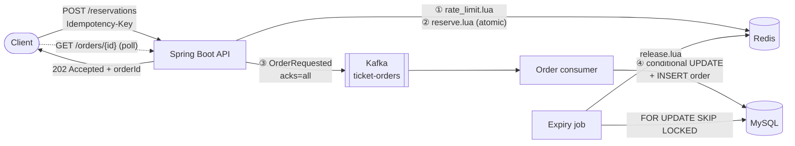

# TicketRush

[](https://github.com/Bastardki11er/ticketrush/actions/workflows/ci.yml)


A ticketing backend built for **flash sales**: thousands of people hit "buy" the
second tickets go on sale, and the system has to sell **exactly** the tickets it
has. No overselling, no lost orders, and response times stay flat.

**Stack:** Java 21 (virtual threads) · Spring Boot 4 · Spring Security (JWT) · MySQL 8.4 · Redis (Lua scripts) · Kafka 4 (KRaft) · Flyway · Testcontainers · Docker Compose · GitHub Actions · Micrometer/Prometheus

## Results

[`scripts/load_test.py`](scripts/load_test.py): **20,000 signed-in users race for 2,000 tickets**, 200 at a time, against the Docker Compose stack. Every request carries a JWT the app verifies.

| Metric | Result |
|---|---|
| Throughput | **10,400 – 10,500 requests/s** once warm (7,500 on the first run after start-up) |
| Latency (median run) | p50 17 ms · p95 35 ms · p99 54 ms |
| Tickets sold | **exactly 2,000 in every run**; the other 18,000 got `SOLD_OUT` |
| Orders persisted to MySQL | 2,000 / 2,000 |

> Measured on one Apple M5 laptop (10 cores, 24 GB) with the app, MySQL, Redis,
> Kafka *and* the load generator all on the same machine, so treat it as a lower
> bound, not a production benchmark. Checking the JWT on every request costs about
> 10% of throughput: the same runs without auth reached 11,550 – 11,800 requests/s. CI runs a smaller version (5,000 users / 500
> tickets) on every push and fails the build if a single ticket is oversold.

## Architecture



A reservation never waits on MySQL:

1. **Rate limit.** A per-user token bucket in Redis rejects bots before they cost anything.
2. **Reserve in Redis.** One Lua script checks the idempotency key, the stock and the per-user limit, then decrements. Redis runs it as a single command, so concurrent buyers can't interleave.
3. **Queue the order.** The order goes to Kafka, and the client gets `202 Accepted` only after the broker acknowledges it (`acks=all`). If Kafka is down, the tickets go straight back.
4. **Persist.** A consumer writes the order to MySQL with a conditional `UPDATE ... WHERE available_tickets >= ?`. MySQL is the source of truth, and Redis is a fast copy of it.
5. **Pay or expire.** The order waits 10 minutes for payment. After that, a scheduled job expires it and puts the tickets back on sale in both stores.

## Design decisions

| Problem | Approach | Trade-off / why |
|---|---|---|
| Overselling under concurrency | Atomic check-and-decrement in a **Redis Lua script** | Locking a MySQL row (`SELECT ... FOR UPDATE`) makes every buyer queue on one row. Optimistic locking under contention means retry storms. Redis does ~100k ops/s on a single thread with no locks. |
| What if Redis is wrong? | **Defense in depth**: a conditional `UPDATE` plus a `CHECK (available_tickets >= 0)` constraint in MySQL | If Redis drifts (restart, bad manual fix), the order is `REJECTED` and nothing is oversold. Covered by the `mysqlStillPreventsOversellingWhenRedisIsOutOfSync` test. |
| Slow DB writes during the spike | **Async persistence via Kafka** | The client polls `GET /orders/{id}` instead of getting the order back right away (eventual consistency), but latency no longer depends on MySQL. |
| Client retries / double clicks | **`Idempotency-Key` header**, stored atomically with the reservation | A retry returns the original order (`Idempotent-Replayed: true`) instead of buying twice. |
| Kafka delivers at least once | **Idempotent consumer**: check by order id, with the primary key as backstop | A redelivered message is a no-op. Poison messages go to a dead-letter topic after 3 retries. |
| Ordering and contention in MySQL | Kafka messages **keyed by event id** | All writes for one event go through a single partition and consumer, so they never contend on the event row. The cost: one very hot event is limited to one partition's throughput (see next steps). |
| Paying vs expiring at the same moment | **Optimistic locking** (`@Version`) on orders | Whichever transaction commits second gets `409 CONCURRENT_MODIFICATION` instead of silently overwriting the first. |
| Running the expiry job on many instances | `SELECT ... FOR UPDATE SKIP LOCKED` in small batches | Instances split the work instead of blocking each other. No leader election needed. |
| Rate limiting across instances | Token bucket in Redis using the **Redis server clock** (`TIME`) | Limits hold cluster-wide and don't depend on app hosts having synchronized clocks. |
| Cache stampede when a sale opens | `@Cacheable(sync = true)` on event metadata | Hundreds of simultaneous first requests trigger one MySQL load instead of hundreds (measured: 50 concurrent misses dropped to 1). |
| Thread-per-request blocking I/O | **Java 21 virtual threads** (`spring.threads.virtual.enabled`) | Plain blocking code that still scales to thousands of concurrent requests. |

## API

Interactive docs: [`/swagger-ui.html`](http://localhost:8080/swagger-ui.html). Authenticated routes take `Authorization: Bearer <token>`.

| Method | Path | Who | Description |
|---|---|---|---|
| `POST` | `/api/auth/register` | anyone | Create an account (username is case-insensitive, password 8 chars to 72 bytes) |
| `POST` | `/api/auth/login` | anyone | Returns a 1-hour HS256 access token |
| `GET` | `/api/auth/me` | user | Who the token belongs to |
| `GET` | `/api/events` | anyone | Upcoming events with live availability, paged |
| `GET` | `/api/events/{id}` | anyone | Event details with live availability |
| `POST` | `/api/events` | admin | Create an event and load its stock into Redis |
| `GET` | `/api/events/{id}/stats` | admin | Tickets sold, revenue, totals per order status, and whether Redis and MySQL agree |
| `POST` | `/api/events/{id}/reservations` | user | Reserve tickets. Header `Idempotency-Key`. Returns `202` |
| `GET` | `/api/orders` | user | My orders, newest first. `?status=PAID&page=0&size=20` |
| `GET` | `/api/orders/{id}` | user | Order status: `PROCESSING` → `PENDING_PAYMENT` → `PAID` / `EXPIRED` / `CANCELLED` |
| `POST` | `/api/orders/{id}/payment` | user | Simulated payment |
| `POST` | `/api/orders/{id}/cancellation` | user | Cancel and release the tickets |
| `GET` | `/actuator/prometheus` | anyone | Metrics, including `ticketrush_reservations_total{outcome=...}` |

Errors use [RFC 9457](https://www.rfc-editor.org/rfc/rfc9457) problem details with a stable `code`, including the ones Spring itself raises (`INVALID_REQUEST`, `UNAUTHORIZED`, `FORBIDDEN`):

```json
{ "status": 409, "code": "SOLD_OUT", "title": "SOLD_OUT", "detail": "No tickets left" }
```

**Auth.** The app signs its own JWTs and checks the signature, issuer and expiry on every request; the `scope` claim carries `user` or `user admin`. Passwords are BCrypt hashes. Logins are throttled to 5 attempts per minute per username, and sign-ups and logins to 30 per minute per client address, both with the Redis token bucket. Wrong passwords and unknown users get the same answer.

**Reconciliation.** Every 30 s a job compares each event's stock in Redis with MySQL. It acts only when the order topic has no lag (otherwise the gap is just orders in flight) and only when the same mismatch shows up twice in a row, then fixes Redis with a compare-and-set so it never overwrites a reservation made in between.

## Run it

You need Docker.

```bash
docker compose up --build -d
```

Ports bind to `127.0.0.1` and can be moved if something already uses them, e.g. `APP_PORT=18080 MYSQL_PORT=13306 docker compose up -d` (also `REDIS_PORT`, `KAFKA_PORT`). Compose creates an admin account `admin` / `ticketrush-admin`; set `ADMIN_PASSWORD` to change it, and `JWT_SECRET` (base64, 32+ bytes) for anything beyond a local demo.

Open [localhost:8080](http://localhost:8080) for a small console: sign in, browse events, buy, pay, see your orders and, as admin, the sales stats.

```bash
login() { curl -s localhost:8080/api/auth/login -H 'Content-Type: application/json' \
  -d "{\"username\":\"$1\",\"password\":\"$2\"}" | python3 -c 'import json,sys; print(json.load(sys.stdin)["accessToken"])'; }
ADMIN=$(login admin ticketrush-admin)

# create an event whose sale is already open
curl -X POST localhost:8080/api/events -H "Authorization: Bearer $ADMIN" -H 'Content-Type: application/json' -d '{
  "name": "Demo Concert", "venue": "SAP Center",
  "startsAt": "2027-06-01T02:00:00Z", "saleStartsAt": "2026-01-01T00:00:00Z",
  "totalTickets": 100, "priceCents": 4999, "perUserLimit": 2 }'

# sign up, then reserve two tickets
curl -X POST localhost:8080/api/auth/register -H 'Content-Type: application/json' \
  -d '{"username": "alice", "password": "correct horse"}'
ALICE=$(login alice 'correct horse')
curl -i -X POST localhost:8080/api/events/1/reservations -H "Authorization: Bearer $ALICE" \
  -H 'Content-Type: application/json' -H 'Idempotency-Key: 7f1c' \
  -d '{"quantity": 2}'

# run the flash-sale load test (signs its own tokens with the dev secret, or --jwt-secret)
python3 scripts/load_test.py --tickets 500 --users 5000 --concurrency 200
```

`docker compose --profile observability up -d` also starts Prometheus on `localhost:9090`.

## Tests

```bash
./mvnw verify
```

| Layer | What it proves |
|---|---|
| Unit tests (`OrderTest`, `ReservationServiceTest`, `StockReconcilerTest`) | The order state machine; Kafka failures return tickets; duplicates aren't republished; stock is reseeded from MySQL after a Redis restart; the reconciler waits out lag and one-off mismatches |
| Integration tests (Testcontainers: real MySQL, Redis and Kafka) | **1,000 concurrent buyers for 100 tickets sell exactly 100**; per-user limits hold under parallel requests; idempotent replays; expiry and cancellation restore stock in both stores; redelivered messages are no-ops; MySQL catches Redis drift; forged, expired and foreign-issuer tokens are rejected; login guessing is throttled; non-admins can't create events or read stats; order history paging and filters; the reconciler repairs a drifted Redis |
| CI load test (Docker Compose) | The real containerized stack sells exactly N tickets under load |

47 tests in all. The integration tests skip themselves on machines without Docker. CI always runs them.

## Project layout

```
src/main/java/com/yitaihuang/ticketrush/
├── auth/          users, BCrypt, JWT issuing, admin bootstrap
├── reservation/   hot path: ReservationService, StockGateway (Lua), RateLimiter, Kafka publisher, StockReconciler
├── order/         Kafka consumer, order state machine, expiry job, history, sales stats
├── event/         events + Caffeine-cached metadata
├── common/        RFC 9457 error handling, after-commit hooks
└── config/        security (JWT, CSP), OpenAPI
src/main/resources/
├── redis/         reserve.lua · release.lua · rate_limit.lua · compare_and_set.lua
├── static/        demo console
└── db/migration/  Flyway schema
```

## Known limitations and next steps

- **Very hot events.** One event lives on one Redis key and one Kafka partition. For a stadium-tour-scale drop, I'd shard the stock across N keys (`stock:{event:1}:0..N`) and spread orders across partitions.
- **Publish-then-timeout.** If Kafka stores the message but the acknowledgment times out, the API returns tickets that were actually sold. MySQL's conditional update still prevents overselling. A transactional outbox would close this gap.
- **Per-address limits behind a proxy.** The sign-up and login limits key on the connecting address. Behind a load balancer every client shares one address, so the app would need to trust `X-Forwarded-For` from that proxy (`server.forward-headers-strategy`).
- **One shared signing key.** HS256 means whoever verifies tokens can also mint them. With more services I'd move to RS256 with a JWKS endpoint, or an identity provider.
- **Role changes wait for the token to expire.** Tokens are stateless, so revoking admin takes up to the 1-hour TTL. Short tokens plus refresh tokens would shrink that.
- **Payments are simulated** to keep the focus on concurrency.

## License

MIT
