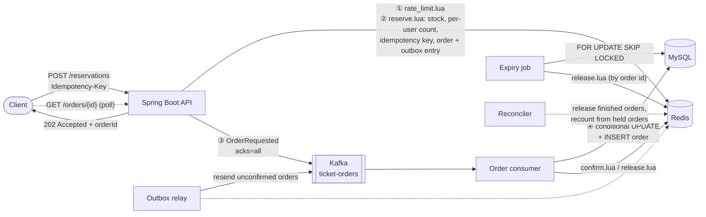

# TicketRush

[](https://github.com/Bastardki11er/ticketrush/actions/workflows/ci.yml)


A ticketing backend built for **flash sales**: thousands of people hit "buy" the
second tickets go on sale, and the system has to sell **exactly** the tickets it
has. MySQL never sells a ticket twice and every order Kafka acknowledged is
persisted; the cases that fall outside that are spelled out under
[Consistency and recovery](#consistency-and-recovery).

**Stack:** Java 21 (virtual threads) · Spring Boot 4 · Spring Security (JWT) · MySQL 8.4 · Redis (Lua scripts) · Kafka 4 (KRaft) · Flyway · Testcontainers · Docker Compose · GitHub Actions · Micrometer/Prometheus

## Results

[`scripts/load_test.py`](scripts/load_test.py) against the Docker Compose stack, driven by [`scripts/consumer_bench.py`](scripts/consumer_bench.py): 20,000 signed-in users (each request carries a JWT the app verifies), 200 in flight at a time, one ticket each. Two scenarios: a **sell-out** (2,000 tickets) and **enough for everyone** (20,000 tickets, so every request becomes an order). Medians of 5 runs per scenario, ranges in brackets. These are the historical A/B runs. Their code snapshot was **reconstructed afterwards** from the saved diff and file timestamps and can't be fully verified (see [`perf/results`](perf/results/README.md)). One later round, with a source snapshot hashed before the build and checked after it, is listed separately there (`perf/results/delivered`: consumer 2,191 messages/s, drain 7.0 s, 202 → visible p99 6.9 s with enough for everyone). It is one sample: it shows that build in the same range as the `batched` runs, and does not re-establish the speed-up. "Delivered" names the code delivered *at that time* (commit `2e4a4ae` plus the working tree recorded in its `env.txt`, before PR #1 was merged), **not the current `main`**: everything since (the claim script, the Redis restart guard and its fenced wipe, the sale cutoff, after-sale processing) has not been benchmarked. What CI checks on every push is correctness under load, not speed.

| | Sell-out: 2,000 tickets | Enough for everyone: 20,000 tickets |
|---|---|---|
| HTTP requests/s (all answers) | **9,500** [6,600 – 10,000] | **8,200** [6,700 – 8,700] |
| Latency of 202 answers | p50 20 ms · p95 45 ms · p99 60 ms | p50 22 ms · p95 41 ms · p99 57 ms |
| Consumer, messages written per second while backlogged | 830 | **2,300** [1,930 – 2,370] |
| Kafka backlog peak (consumer lag) | ~1,900 | ~18,800 |
| Backlog drained after the last response | 0.45 s | 6.5 s |
| 202 → `GET /orders/{id}` shows the order (sampled) | p50 2.0 s · p95 2.2 s · p99 2.2 s | p50 4.2 s · p95 6.3 s · p99 6.4 s |
| Correctness, every run | exactly 2,000 sold, 2,000 persisted, stores agree | 20,000 sold and persisted, stores agree |

In these runs the HTTP side answered ~8–9k requests/s, with 202 answers at p99 ≤ 60 ms. The order writer was the slower half: all orders for one event share one Kafka partition and one consumer thread. When nearly every request succeeded, the backlog was the whole burst, and an order showed `PROCESSING` for up to ~6 s.

### Consumer batching, before and after

The consumer used to write each message in its own transaction. Measured on the version with all the reliability work (same script, machine and scenarios, the two sides run one after the other on fresh stacks; raw results in [`perf/results/`](perf/results/), compared with [`perf/compare.py`](perf/compare.py)):

| Enough for everyone, medians of 5 [range] | One transaction per message | One transaction per poll (≤ 200) |
|---|---|---|
| Consumer messages/s while backlogged | 982 [808 – 1,003] | **2,304** [1,930 – 2,374] |
| Backlog drained after the last response | 18.2 s [17.6 – 22.3] | **6.5 s** [6.2 – 7.4] |
| 202 → visible p50 / p95 / p99 | 10.0 / 17.4 / 18.1 s | **4.2 / 6.3 / 6.4 s** |
| HTTP requests/s | 8,410 [7,917 – 8,655] | 8,158 [6,702 – 8,673] (ranges overlap: five runs can't confirm a difference either way) |
| Consumer transaction time per order (app side, Redis claim included) | 1,055 µs | 451 µs |
| of which the Redis claim | 122 µs | 155 µs |
| The consumer's MySQL statements per order: INSERT · UPDATE · COMMIT · `SET autocommit` | 1 · 1 · 1 · 2 | 0.01 · 1 · 0.005 · 0.01 |

What the measurement pointed at (statement counts and MySQL time from `performance_schema` digests; the load test's own status polling, which runs read-only transactions, left out): per order, MySQL spent most of its time in the `COMMIT` (a log flush each), and the app paid six round trips. Batching keeps every per-order step (look up by id, claim in Redis, conditional stock decrement) and shares one commit and one multi-row `INSERT` (`rewriteBatchedStatements`) across the poll. The sell-out improves too, though five runs show it less cleanly (consumer 548 → 827 messages/s, ranges 381–571 vs 497–877, overlapping; drain 1.7 s → 0.45 s). Not measured further: the remaining per-order cost is the stock `UPDATE` and the Redis claim, one round trip each.

The cost: a batch transaction holds the event's stock row for its whole run, typically ~70 ms and, under the load test, up to ~1 s at p99 (`ticketrush_orders_write_seconds`). A cancellation or expiry for the same event waits that long.

Older measurements, for context: the outbox and recovery work cost a median 4–7% of requests/s against the commit before it (the ranges overlap, so six runs per side can't confirm the difference) and ~10% of consumer speed (one more Redis call per order). The hardening round added one `INCRBY` to `reserve.lua`: 83,200 vs 86,200 script calls/s on Redis alone (`redis-benchmark`, medians of 5; the ranges overlap, so five rounds can't confirm the difference), p99 0.80 ms on both.

> Measured on one Apple M5 laptop (10 cores, 24 GB, macOS 27), Docker Desktop 4.94 with
> 10 CPUs and 8 GB for the VM, running the app, MySQL, Redis (AOF on at the time; compose now runs it without persistence), Kafka *and* the load
> generator together. The script also polls order status, the stats endpoint and consumer lag
> while it runs, which costs some throughput (the earlier, simpler script saw ~10k requests/s).
> These are observations for this machine, this load and these few runs, not a production
> benchmark, and they don't bound what another setup would do, up or down. CI runs a smaller
> version of both scenarios on every push and fails on a single oversold or lost order.

## Architecture



A reservation never waits on MySQL:

1. **Rate limit.** A per-user token bucket in Redis rejects bots before they cost anything.
2. **Reserve in Redis.** One Lua script checks the idempotency key, the stock and the per-user limit, then decrements the stock and records the order itself (the exact Kafka message) as *held* and *unconfirmed*. Redis runs it as a single command, so concurrent buyers can't interleave.
3. **Queue the order.** The order goes to Kafka. Normally the client gets `202 Accepted` after the broker acknowledges it (`acks=all`). If the producer fails before the record is even queued, the tickets go straight back (`503`). If the ack just doesn't come back, the outcome is unknown: the tickets stay held, the client still gets its `202`, and the outbox relay resends the same message until Kafka confirms it. Those two kinds of `202` have different durability (see [What a 202 means](#what-a-202-means)).
4. **Persist.** A consumer writes the order to MySQL with a conditional `UPDATE ... WHERE available_tickets >= ?`, then confirms it in Redis. MySQL is the source of truth for orders; Redis is the fast, self-consistent copy the hot path reads.
5. **Pay or expire.** The order waits 10 minutes for payment. After that, a scheduled job expires it and puts the tickets back on sale in both stores. Releases are keyed by order id, so they happen at most once.

**The sale ends when the event starts.** A new reservation at or after `startsAt` gets `409 SALE_ENDED`. The app checks its own clock before Redis, and the reserve script checks again with Redis's clock (`TIME`) in the same atomic step that would create the order, after the idempotency check. So a request that passed the first check and then paused past the start is refused too, a retry of a request accepted before the start still gets its original order without reserving or publishing anything, and no order can enter the outbox after the start by Redis's clock. The boundary is exact per clock, not across clocks: with app hosts and Redis skewed, a request near the start is decided by whichever check runs on the later-reading clock. After a Redis loss, a retry after the start whose idempotency key Redis no longer has gets `SALE_ENDED`, like a new request (the order itself, if it reached MySQL, is unaffected).

**Accepted orders keep being processed after the start.** The outbox relay and the reconciler don't work only on events on sale: they visit every event whose sale has begun and that isn't *settled* yet. An event is settled (`events.settled_at`) by a reconciler run at least an hour after its start (`ticketrush.reconciliation.settle-after`, past the payment window and any clock skew) that found nothing to fix and an empty outbox; no order can join the outbox after the start, by Redis's clock. Everything else that may still need the jobs is a MySQL write, and each one reopens the event in the same transaction: a stock change (an order stored, cancelled or expired), a rejected order, a recorded dead letter, a void. The settle is a compare-and-set on a version (`events.upkeep_version`) read before the checks, so a write that lands while the reconciler is checking keeps the event in, whichever instance settles it. So an order accepted just before the start is still resent and stored, and a cancellation or expiry after the start is still released in Redis, while past events don't pile up in every run. After the V4 migration every event whose sale has begun is visited once (and rebuilt in Redis if its state is gone) before it settles. Orders that existed only in Redis when Redis lost its data are still lost (see below).

## Design decisions

| Problem | Approach | Trade-off / why |
|---|---|---|
| Overselling under concurrency | Atomic check-and-decrement in a **Redis Lua script** | Locking a MySQL row (`SELECT ... FOR UPDATE`) makes every buyer queue on one row. Optimistic locking under contention means retry storms. Redis does ~100k ops/s on a single thread with no locks. |
| What if Redis is wrong? | **Defense in depth**: a conditional `UPDATE` plus a `CHECK (available_tickets >= 0)` constraint in MySQL | If Redis drifts (restart, bad manual fix), the order is `REJECTED` and nothing is oversold. Covered by the `mysqlStillPreventsOversellingWhenRedisIsOutOfSync` test. |
| Kafka ack times out, or the app dies right after reserving | **The Redis order record doubles as an outbox**; a relay resends unconfirmed orders under the same order id | A transactional outbox in MySQL would put a database write on every reservation, the one thing the hot path avoids. The order is already recorded atomically with its reservation in Redis, so the only new hot-path cost is one `ZREM` after the ack. The price: an unconfirmed order is only as durable as Redis (see [What a 202 means](#what-a-202-means)). |
| Releasing the same tickets twice | **Release by order id**: the script flips the order to `R` and only the first call returns tickets | Cancel, expiry, a rejected order, the reconciler and retries can all try to release the same order; only one wins. The marker lives with the event's other keys and has no TTL of its own, so it can't lapse while a retry is still possible. |
| Slow DB writes during the spike | **Async persistence via Kafka** | The client polls `GET /orders/{id}` instead of getting the order back right away (eventual consistency), but latency no longer depends on MySQL. |
| Client retries / double clicks | **`Idempotency-Key` header**, stored atomically with the reservation | A retry returns the original order (`Idempotent-Replayed: true`) instead of buying twice. |
| Kafka delivers at least once | **Idempotent consumer**: check by order id, with the primary key as backstop | A redelivery of the *same* order is a no-op (it only re-syncs Redis). A constraint error is skipped only if the stored row is that exact order; anything else (a foreign key, the same idempotency key under another order id, the same id with different details) is retried and then dead-lettered instead of silently dropped. |
| Ordering and contention in MySQL | Kafka messages **keyed by event id** | All writes for one event go through a single partition and consumer, so they never contend on the event row. The cost: one very hot event is limited to one partition's throughput (see next steps). |
| Paying vs expiring at the same moment | **Optimistic locking** (`@Version`) on orders | Whichever transaction commits second gets `409 CONCURRENT_MODIFICATION` instead of silently overwriting the first. |
| Running the expiry job on many instances | `SELECT ... FOR UPDATE SKIP LOCKED` in small batches | Instances split the work instead of blocking each other. No leader election needed. |
| Rate limiting across instances | Token bucket in Redis using the **Redis server clock** (`TIME`) | Limits hold cluster-wide and don't depend on app hosts having synchronized clocks. |
| Cache stampede when a sale opens | `@Cacheable(sync = true)` on event metadata | Hundreds of simultaneous first requests trigger one MySQL load instead of hundreds (measured: 50 concurrent misses dropped to 1). |
| Thread-per-request blocking I/O | **Java 21 virtual threads** (`spring.threads.virtual.enabled`) | Plain blocking code that still scales to thousands of concurrent requests. |

## API

Interactive docs: [`/swagger-ui.html`](http://localhost:8080/swagger-ui.html). Authenticated routes take `Authorization: Bearer <token>`.

| Method | Path | Who | Description |
|---|---|---|---|
| `POST` | `/api/auth/register` | anyone | Create an account (username is case-insensitive, password 8 chars to 72 bytes) |
| `POST` | `/api/auth/login` | anyone | Returns a 1-hour HS256 access token |
| `GET` | `/api/auth/me` | user | Who the token belongs to |
| `GET` | `/api/events` | anyone | Upcoming events with live availability, paged |
| `GET` | `/api/events/{id}` | anyone | Event details with live availability |
| `POST` | `/api/events` | admin | Create an event and load its stock into Redis |
| `GET` | `/api/events/{id}/stats` | admin | Tickets sold, revenue, totals per order status, and whether Redis and MySQL agree |
| `GET` | `/api/admin/order-failures` | admin | Dead-lettered order messages, newest first (100). `?status=OPEN` |
| `POST` | `/api/admin/order-failures/{id}/replay` · `/void` · `/discard` | admin | Resolve one (see [Dead-lettered orders](#dead-lettered-orders)). Optional body `{"note": "..."}` |
| `POST` | `/api/events/{id}/reservations` | user | Reserve tickets. Header `Idempotency-Key`. Returns `202`. From `saleStartsAt` until the event's `startsAt`; after that `409 SALE_ENDED`, except a retry of an accepted request (same user and key), which gets its order back |
| `GET` | `/api/orders` | user | My orders, newest first. `?status=PAID&page=0&size=20` |
| `GET` | `/api/orders/{id}` | user | Order status: `PROCESSING` → `PENDING_PAYMENT` → `PAID` / `EXPIRED` / `CANCELLED`; `UNDER_REVIEW` if it was dead-lettered and waits for an operator (tickets held), `REJECTED` if given up. Someone else's order is `404` |
| `POST` | `/api/orders/{id}/payment` | user | Simulated payment |
| `POST` | `/api/orders/{id}/cancellation` | user | Cancel and release the tickets |
| `GET` | `/actuator/prometheus` | anyone | Metrics, including `ticketrush_reservations_total{outcome=...}` |

Errors use [RFC 9457](https://www.rfc-editor.org/rfc/rfc9457) problem details with a stable `code`, including the ones Spring itself raises (`INVALID_REQUEST`, `UNAUTHORIZED`, `FORBIDDEN`):

```json
{ "status": 409, "code": "SOLD_OUT", "title": "SOLD_OUT", "detail": "No tickets left" }
```

**Amounts.** A ticket costs at most 100,000,000 cents ($1,000,000.00); a higher `priceCents` is `400 INVALID_REQUEST`. With at most 10 tickets an order, every total fits the `int` amount columns, and the total is computed with a checked multiply: an event stored before this limit whose total would not fit gets `400 AMOUNT_OUT_OF_RANGE` before any ticket is held.

**Auth.** The app signs its own JWTs and checks the signature, issuer and expiry on every request; the `scope` claim carries `user` or `user admin`. Passwords are BCrypt hashes. Logins are throttled to 5 attempts per minute per username, and sign-ups and logins to 30 per minute per client address, both with the Redis token bucket. Wrong passwords and unknown users get the same answer.

`503` answers are safe to retry with the same `Idempotency-Key`: `ORDER_QUEUE_UNAVAILABLE` (Kafka unreachable or not confirming orders) and `STOCK_RECOVERING` (Redis is being rebuilt, see below).

## Consistency and recovery

Redis and MySQL never hold the same number: between the Redis reservation and the consumer's insert, an order exists only in Redis and Kafka. So instead of comparing stock counts, the system keeps three invariants and repairs only what breaks them.

| Invariant | Where it is kept |
|---|---|
| **I1** Redis: `stock + held = total`, where `held` is the tickets of held orders, and each user's count = the tickets they hold | Every Redis script changes stock, the `held` counter, per-user counts and the order record together, atomically |
| **I2** MySQL: `available + tickets of PENDING_PAYMENT/PAID orders = total` | Each transaction changes the stock row and the order row together |
| **I3** Orders Redis holds = orders active in MySQL + orders in flight + dead-lettered orders awaiting a decision | The consumer claims each order in Redis before writing it and releases it if MySQL rejects it; the reconciler applies releases that got lost |

Each event's Redis state: `stock`, `held`, `buyers` (user → tickets), `idem:<user>:<key>` → order id, `orders` (order id → the order message while held, `R` once released), `outbox` (orders Kafka hasn't confirmed, scored by accept time) and `sent` (held orders that may already exist in Kafka).

**An order is released or claimed, never both.** Three parties can act on an order that Kafka hasn't confirmed: the request (which may conclude its send never left the producer and release it), the relay (which resends it) and the consumer (which stores it). The relay and the consumer each mark the order `sent` in the same Lua call that hands it to them, and the request's "not sent" release refuses, in its own single call, if that mark is there; the request then answers `202` instead of `503`. The consumer's claim also refuses an order that is already released: it is stored as `REJECTED` and takes no stock. That second check also covers the case where "not sent" was simply wrong (Spring Kafka throws from `send()` only when the producer failed before queueing the record, but the app doesn't have to trust that blindly).

| Failure | What happens |
|---|---|
| Kafka ack times out (message may or may not be stored) | Tickets stay held, client gets `202`. The relay resends after 10 s under the same order id; the consumer keeps the first copy. The order leaves the outbox when Kafka acks or the consumer claims it. |
| Producer fails before queueing the record (brokers unreachable for `max.block.ms`) | Not sent by this request: tickets released, idempotency key forgotten, `503`, unless the relay or consumer already took the order, in which case `202`. |
| The relay resends an order while its request is releasing it as not sent | Whichever reaches Redis first wins; the other backs off (see above). |
| Redis ran the reservation but the reply was lost, the client retries | The retry gets the original order id (`Idempotent-Replayed: true`); the relay publishes the order, which was waiting in the outbox. |
| App crashes between reserving and publishing | Same: the outbox entry is resent by the relay. |
| An order sits unconfirmed for 30 s | New reservations for that event get `503 ORDER_QUEUE_UNAVAILABLE` until Kafka catches up, instead of piling up orders only Redis knows about. |
| Kafka redelivers a message, or two consumers race on it | One order row; Redis is re-synced idempotently. |
| The consumer dies after a batch's commit, before Kafka has its offsets | The whole batch comes again; every order is found by id and only re-synced. |
| One message in a batch fails (bad JSON, a constraint) | The batch's transaction rolls back as a whole and its messages are redone one at a time. The error handler commits the offsets before the failing one, retries it, and dead-letters only that message; its neighbours are stored. |
| App dies after MySQL commits a cancel/expiry, before Redis hears of it | The reconciler (every 30 s) finds orders Redis still holds that MySQL has finished and releases them, at most once. |
| Someone edits the stock key, or a bug breaks I1 | The reconciler's **stock-count invariant check** (`stock + held = total`, O(1)) notices, and only then recounts stock and per-user counts from the held orders in one Lua call. It never copies MySQL's number, which would put orders in flight on sale twice. The check covers the two counters only; it is not an audit (see [Auditing and manual repair](#auditing-and-manual-repair)). |
| Redis restarts, fails over, or loses an event's data | See [Redis recovery](#redis-recovery). |
| The consumer gives up on a message (3 retries) | See [Dead-lettered orders](#dead-lettered-orders). |

### What a 202 means

Four different things, which survive different failures:

| State | How the client tells | Survives | Can still end as |
|---|---|---|---|
| **Accepted in Redis only** (an ack that never came back, or a not-sent release the relay pre-empted) | `202`, then `PROCESSING` | An app crash: the relay resends it within ~10 s. **Not** a Redis restart or loss: the order is gone, `GET /api/orders/{id}` returns `404`, and a retry with the same `Idempotency-Key` places a fresh order. | lost |
| **Acknowledged by Kafka** (the normal path) | `202`, then `PROCESSING` | Any app or Redis failure: it is in Kafka (`acks=all`) and reaches MySQL. | `REJECTED`, if MySQL has no stock left for it, if its message reached Kafka only after a Redis rebuild, or reached the consumer while a Redis that came back with older data had not been caught yet (both below), or if it was dead-lettered and then voided, or replayed after a rebuild |
| **An order** | `GET` shows `PENDING_PAYMENT`, then `PAID` | It is a MySQL row. | `EXPIRED` or `CANCELLED` (tickets go back on sale) |
| **Dead-lettered** (the consumer gave up on it, see below) | `GET` shows `UNDER_REVIEW`: its failure record is in MySQL, so this lasts beyond the 10-minute `PROCESSING` marker. Only for its owner, and only if the message is a readable order; nothing of the error, the payload or the operator's notes is shown | It is a MySQL row (`order_failures`), tickets held | `PROCESSING` after a replay, then the stored order; `REJECTED` after a void |

Only an order is a sale. The first kind is what the outbox trades for keeping MySQL off the hot path; a MySQL outbox would remove it at the cost of a database write per reservation.

### Redis recovery

What the recovery is built for is **Redis losing everything it had**. Other Redis failures are turned into that, with one exception:

| Redis failure | Handled how | Guarantees |
|---|---|---|
| Restart without persistence (the compose setup: `--save "" --appendonly no`), `FLUSHALL` | Stock keys are gone: `503 STOCK_RECOVERING` at once, then the rebuild below | All of them: no overselling, per-user limits, idempotency, every Kafka-acknowledged order reaches MySQL |
| Redis comes back with *older* data (an AOF or RDB file, a restored snapshot) while every app instance is down | [`RedisRestartGuard`](src/main/java/com/yitaihuang/ticketrush/reservation/RedisRestartGuard.java): the record of the trusted server's `run_id` comes back with the old data, and `run_id` changes on every start, so the mismatch is certain. An instance refuses reservations and rebuilds until its own check has passed (default deny), and the first check runs when the app is ready | All of them |
| A *running* app's Redis is replaced by one with older data (a restart with persistence, failover to a replica that was behind) | The same check, every second per instance. Exactly one instance wipes (the compare and the wipe lock are one Lua call), and nobody sells or rebuilds until the wipe is complete; a wiper that dies is redone when its 1-minute lock expires. The lock holds a token new to each attempt, checked in the same Lua call as every delete batch, lease renewal and the final "trusted" mark, so a wiper that stalled past its lease stops without touching what its successor rebuilt. Only a single Redis server (optionally with replicas and failover) is supported, not Redis Cluster: the wipe and the restart record span all events' keys, which a cluster would refuse as cross-slot | **Not all, for up to ~1 s per instance** before its check runs: reservations use the old state. MySQL still prevents overselling (Redis may overstate stock; the extra `202`s end `REJECTED`), and Kafka-acknowledged orders still reach MySQL (as `REJECTED` if Redis forgot them). Per-user limits can be exceeded, and a retry whose idempotency key Redis forgot becomes a new attempt (the MySQL unique key turns it into a dead letter instead of a second order). After the check: one wipe, then the rebuild below |
| Some keys of a running server disappear (a hand-made `DEL`; eviction is off with `maxmemory-policy noeviction`) | Not detected | Unsupported; repair by hand (below) |

When an event's stock key is missing, reservations get `503 STOCK_RECOVERING` (retry with the same key) until one instance has rebuilt the event from MySQL: held orders, released markers, per-user counts, idempotency keys, then stock. Before it may start, two things must be true:

1. **A quiet period has passed** since the loss was first noticed (12 s, recorded in Redis with Redis's own clock). It exceeds `max.block.ms + delivery.timeout.ms` (1 s + 10 s), so sends that were already inside the producer when Redis was lost have either landed in Kafka or failed.
2. **Consumer lag is 0** after that, so everything that did land is in MySQL.

No timer covers a request that reserved tickets and then paused *before* calling the producer (a long GC pause, a stalled thread): its message can reach Kafka after the rebuild, when its tickets, or its user's limit, may belong to someone else. **The consumer rejects any order Redis doesn't know while the event's stock key exists**: it is stored as `REJECTED` and takes nothing. No clock is involved; the rule is sound because, with the guard above, Redis never runs on a partial old state, so an order it doesn't know is always older than its current state. An order the consumer claims *during* the rebuild (no stock key yet) is held and counted by the rebuild.

The rebuild runs under a lease holding a random token. Every seeding script and the final recount check the token inside Redis, so a rebuilder that stalled past its lease, or whose Redis was wiped again meanwhile, can't write into a newer rebuild (the token fences rebuilders from each other, not old senders: that is the rejection rule's job); only the fenced final step may create the stock key (the reconciler's routine recount skips a missing key). If a rebuilder crashes, its lease expires after 30 s and the next one starts over, which is safe because seeding never overwrites what is there.


### Auditing and manual repair

The stock-count check proves only that two counters add up. It can't tell whether the orders hash matches MySQL's orders, whether per-user counts are right, or whether MySQL's `available` matches MySQL's own active orders. A full audit of one event compares all of that, and is only meaningful while nothing is in flight (outbox empty, consumer lag 0); otherwise every difference may be an order on its way:

| Check | Redis | MySQL |
|---|---|---|
| Held orders | `HGETALL ticketrush:{event:<id>}:orders`, entries other than `R` | `SELECT id, quantity FROM orders WHERE event_id = ? AND status IN ('PENDING_PAYMENT','PAID')` |
| Per-user counts | `HGETALL ticketrush:{event:<id>}:buyers` | the same rows, summed per `user_id` |
| Stock | `GET …:stock` and `…:held` | `available_tickets` and `total_tickets` from `events` |

[`AbstractIntegrationTest.assertStoresAgree`](src/test/java/com/yitaihuang/ticketrush/AbstractIntegrationTest.java) is exactly this audit, and every consistency test ends with it. There is no production audit job and no "pause sales" switch, so a repair stops the app:

1. **Stop the writers**: every app instance (`docker compose stop app`). Reservations, the consumer, the relay, expiry and the reconciler all stop; Kafka keeps what isn't consumed yet.
2. **Back up**: `docker compose exec redis redis-cli --rdb /tmp/before.rdb` (then `docker compose cp redis:/tmp/before.rdb .`) and `docker compose exec mysql mysqldump --no-tablespaces -uticketrush -p ticketrush events orders order_failures > before.sql`.
3. **Write down the outbox**: `ZRANGE ticketrush:{event:<id>}:outbox 0 -1`. Those are Redis-only orders; the repair loses them.
4. **Repair.** Redis: delete *all* of the event's keys, not only `stock`: `redis-cli --scan --pattern 'ticketrush:{event:<id>}:*' | xargs redis-cli unlink`. MySQL, only if its own stock is wrong (I2): in a transaction, `UPDATE events e SET available_tickets = total_tickets - (SELECT COALESCE(SUM(quantity), 0) FROM orders WHERE event_id = e.id AND status IN ('PENDING_PAYMENT','PAID')) WHERE id = ?`, check the new value, then `COMMIT`.
5. **Start the app.** The consumer works off Kafka first; the fenced rebuild runs once the quiet period has passed and the lag is 0.
6. **Audit again** once the lag is 0 and the outbox is empty.

Deleting an event's keys while the app runs is what the guard does on a Redis restart, and it is safe in the sense that the rebuild takes over, but it drops the outbox (Redis-only orders) and stops that event's sales for at least the quiet period, so it is not a routine fix.

### Dead-lettered orders

After 3 failed attempts a message goes to `ticket-orders.DLT`. A listener records it in `order_failures` (the payload as received, the root-cause exception, attempt count) and counts it (`ticketrush_orders_dead_lettered_total`; `ticketrush_orders_failures_open` is the number still open, the one to alert on). Its tickets stay held: nothing is guessed. An admin then decides. A payload that isn't one of our orders (malformed JSON, a JSON `null`, an empty or field-less object) is kept as received with no order id, and can only be discarded.

What is kept along the way, and on what it rests:

- **The DLT send fails** (Kafka unreachable): the dead-letter publisher waits for the send and throws (`failIfSendResultIsError`, Spring Kafka's default, not changed here). The error handler then puts the record back in the seek and does not commit its offset, so the original message stays where it was and is delivered again. Checked in the Spring Kafka 4.1.1 source (`DeadLetterPublishingRecoverer`, `FailedBatchProcessor`, `SeekUtils`); not covered by a test here.
- **Recording fails** (MySQL down): the DLT listener retries forever (`deadLetterContainerFactory`), so the dead letter stays on its topic until it is recorded. Recording needs MySQL only, not Redis, so a Redis outage does not stop it.
- **The record is complete**: the payload column is `MEDIUMTEXT` (16 MB, above Kafka's default 1 MB message limit) and stores the message unchanged, which [`DeadLetterIntegrationTest`](src/test/java/com/yitaihuang/ticketrush/order/DeadLetterIntegrationTest.java) checks for a failure MySQL caused; the error text is cut at 1,000 characters. Nothing in the record depends on why the consumer failed, but a Redis outage itself isn't simulated in the tests.

None of this makes the order a sale: a recorded dead letter is a kept message; it becomes an order only if a replay succeeds.

An admin's options:

```bash
ADMIN=$(login admin ticketrush-admin)   # see "Run it"
curl -s localhost:8080/api/admin/order-failures?status=OPEN -H "Authorization: Bearer $ADMIN"
curl -s -X POST localhost:8080/api/admin/order-failures/7/replay  -H "Authorization: Bearer $ADMIN"
curl -s -X POST localhost:8080/api/admin/order-failures/7/void    -H "Authorization: Bearer $ADMIN" \
  -H 'Content-Type: application/json' -d '{"note": "user id too long"}'
curl -s -X POST localhost:8080/api/admin/order-failures/9/discard -H "Authorization: Bearer $ADMIN"
```

| Action | Does | Allowed when |
|---|---|---|
| `replay` | Sends the original message again, same order id (the consumer is idempotent). Reopens if it fails again. | The message is an order and the failure isn't voided or discarded |
| `void` | Stores the order as `REJECTED` if MySQL accepts the row, and releases its tickets in Redis. Final: a copy that arrives later finds the rejected row (or, if no row could be stored, the released marker) and can't become active. | The order isn't active in MySQL (otherwise: cancel it) |
| `discard` | Marks it handled without touching stock. | The message isn't a readable order (its payload is kept for diagnosis), or its order already exists in MySQL |

All three are idempotent. Every failure window above has an integration test that drives it through real Redis, Kafka and MySQL and then checks I1–I3, the `held` counter, the outbox, the `sent` set and every idempotency key together: [`ConsistencyIntegrationTest`](src/test/java/com/yitaihuang/ticketrush/reservation/ConsistencyIntegrationTest.java), [`PublishReleaseRaceIntegrationTest`](src/test/java/com/yitaihuang/ticketrush/reservation/PublishReleaseRaceIntegrationTest.java), [`RecoveryIntegrationTest`](src/test/java/com/yitaihuang/ticketrush/reservation/RecoveryIntegrationTest.java), [`DeadLetterIntegrationTest`](src/test/java/com/yitaihuang/ticketrush/order/DeadLetterIntegrationTest.java). Interleavings are pinned with latches and explicit state changes, not sleeps.

## Run it

You need Docker.

```bash
docker compose up --build -d
```

Ports bind to `127.0.0.1` and can be moved if something already uses them, e.g. `APP_PORT=18080 MYSQL_PORT=13306 docker compose up -d` (also `REDIS_PORT`, `KAFKA_PORT`). Compose creates an admin account `admin` / `ticketrush-admin`; set `ADMIN_PASSWORD` to change it. Tokens are signed with `JWT_SECRET`, which Compose passes through to the app:

- unset or empty: the public development key (the app logs a warning). Fine for a local demo only, since anyone can sign tokens with it;
- set, e.g. `JWT_SECRET=$(openssl rand -base64 32) docker compose up -d`: that key and only that key; tokens signed with the development key are refused;
- not valid base64, or shorter than 32 bytes: the app refuses to start and says why (without printing the value).

The load-test scripts sign their own tokens, so give them the same key (`--jwt-secret` or the `JWT_SECRET` variable).

Open [localhost:8080](http://localhost:8080) for a small console: sign in, browse events, buy, pay, see your orders and, as admin, the sales stats.

```bash
login() { curl -s localhost:8080/api/auth/login -H 'Content-Type: application/json' \
  -d "{\"username\":\"$1\",\"password\":\"$2\"}" | python3 -c 'import json,sys; print(json.load(sys.stdin)["accessToken"])'; }
ADMIN=$(login admin ticketrush-admin)

# create an event whose sale is already open
curl -X POST localhost:8080/api/events -H "Authorization: Bearer $ADMIN" -H 'Content-Type: application/json' -d '{
  "name": "Demo Concert", "venue": "SAP Center",
  "startsAt": "2027-06-01T02:00:00Z", "saleStartsAt": "2026-01-01T00:00:00Z",
  "totalTickets": 100, "priceCents": 4999, "perUserLimit": 2 }'

# sign up, then reserve two tickets
curl -X POST localhost:8080/api/auth/register -H 'Content-Type: application/json' \
  -d '{"username": "alice", "password": "correct horse"}'
ALICE=$(login alice 'correct horse')
curl -i -X POST localhost:8080/api/events/1/reservations -H "Authorization: Bearer $ALICE" \
  -H 'Content-Type: application/json' -H 'Idempotency-Key: 7f1c' \
  -d '{"quantity": 2}'

# run the flash-sale load test (signs its own tokens with the dev secret, or --jwt-secret)
python3 scripts/load_test.py --tickets 500 --users 5000 --concurrency 200
```

`docker compose --profile observability up -d` also starts Prometheus on `localhost:9090`.

## Tests

```bash
./mvnw verify
```

| Layer | What it proves |
|---|---|
| Unit tests (`OrderTest`, `ReservationServiceTest`, `OrderRequestPublisherTest`, `StockReconcilerTest`, `SecurityConfigTest`) | The order state machine; "not sent" vs "maybe stored" Kafka results and what each does to the tickets; duplicates aren't republished; a missing Redis state is rebuilt or refused; the reconciler only releases orders MySQL has finished and never copies MySQL's stock |
| Integration tests (Testcontainers: real MySQL, Redis and Kafka) | **1,000 concurrent buyers for 100 tickets sell exactly 100**; the reconciler running non-stop during a sale with cancellations never sells a ticket twice; every failure window above, including the relay racing a not-sent release, a rebuild with an old sender still running, an order that reaches Kafka only after the rebuild (whatever its sender's clock says), a Redis that came back with older data, 8 instances recovering at once, a rebuild that crashed halfway, replaying, voiding and redelivering dead-lettered orders, a void racing the consumer of a replayed copy, and the batch consumer's duplicates, rollbacks, poison messages and overlapping batches during a rebalance; per-user limits hold under parallel requests; idempotent replays; expiry and cancellation restore stock in both stores; MySQL catches Redis drift; forged, expired and foreign-issuer tokens are rejected; login guessing is throttled; non-admins can't create events or read stats; order history paging and filters |
| CI load test (Docker Compose) | The real containerized stack sells exactly N tickets under load, and persists every order when there is enough for everyone |

130 tests in all (`./mvnw clean verify`, also in CI). The integration tests skip themselves on machines without Docker. CI always runs them.

## Project layout

```
src/main/java/com/yitaihuang/ticketrush/
├── auth/          users, BCrypt, JWT issuing, admin bootstrap
├── reservation/   hot path: ReservationService, StockGateway (Lua), RateLimiter, Kafka publisher;
│                  OrderOutboxRelay, StockReconciler, StockRecovery, RedisRestartGuard
├── order/         Kafka consumer, order state machine, expiry job, history, sales stats,
│                  dead-letter listener + OrderFailureService (replay / void / discard)
├── event/         events + Caffeine-cached metadata
├── common/        RFC 9457 error handling, after-commit hooks
└── config/        security (JWT, CSP), OpenAPI
src/main/resources/
├── redis/         reserve · release · confirm (consumer claim) · due (outbox) · drift + recount (repair)
│                  rebuild_begin · seed · rebuild_lease (fenced rebuild) · rate_limit
├── static/        demo console
└── db/migration/  Flyway schema
scripts/           load_test.py, consumer_bench.py (records a benchmark run), mixed_load.py
perf/              compare.py; results/: raw benchmark runs
```

## Known limitations and next steps

- **Very hot events.** One event lives on one Redis key and one Kafka partition. For a stadium-tour-scale drop, I'd shard the stock across N keys (`stock:{event:1}:0..N`) and spread orders across partitions.
- **A `202` is not a sale.** Redis-only `202`s are lost with Redis, and Kafka-acknowledged ones can still end `REJECTED`. See [What a 202 means](#what-a-202-means).
- **Dead-lettered orders need a human.** Recording, metrics and replay/void/discard exist, but nothing decides automatically, and an open failure's tickets stay held (not sold) until someone does. There is no alerting rule shipped, only the `ticketrush_orders_failures_open` gauge to alert on.
- **A batch holds its event's stock row.** The consumer's batch transaction (≤ 200 orders) keeps the event row locked until it commits: ~70 ms typically, up to ~1 s at p99 under the load test. Cancellations and expiries for that event wait meanwhile. Measured with [`scripts/mixed_load.py`](scripts/mixed_load.py) (a 20,000-order burst while a third of the orders are paid, a third cancelled and a third expire, 4 rounds, [`perf/results/mixed-batch200`](perf/results/mixed-batch200)): no deadlocks, no lock timeouts, no failed request; ~7,000 row-lock waits per round, 47 ms on average, longest 1.6 s *in these runs* (a measured maximum, not a bound: a slower machine or bigger batches would wait longer); cancellation p50 28 ms, p99 0.13–0.32 s, longest 1.6 s; payment (no stock row) p50 2.5 ms; every order settled within ~2 s of its expiry time. Fewer records per poll would shorten the waits at the cost of throughput; at these numbers I left it at 200.
- **One stuck order pauses its event.** An order Kafka won't confirm for 30 s stops new reservations for that event. That's deliberate (it bounds how much only Redis knows), but there's no automatic give-up.
- **Every Redis restart costs a rebuild.** Any restart, failover or restored snapshot means `503 STOCK_RECOVERING` for every event for at least the 12 s quiet period, and the Redis-only orders are lost. Orders whose message reaches Kafka only after the rebuild are rejected, even if there was stock.
- **Failover is detected, not seamless.** If a running app's Redis is replaced by one with older data, per-user limits and idempotency are not guaranteed for up to ~1 s per instance, until its check runs (see [Redis recovery](#redis-recovery)). Closing that window would need the server check inside every reservation script.
- **A Redis outage dead-letters orders.** The consumer must claim each order in Redis before writing it, so while Redis is unreachable every message fails, is retried 3 times and is dead-lettered. That is a retained message, not an order: the client's `GET` shows `PROCESSING` until the dead letter is recorded, then `UNDER_REVIEW` until someone replays it (`PROCESSING` again, then the stored order) or voids it (`REJECTED`); see [Dead-lettered orders](#dead-lettered-orders) for what is kept.
- **The full recount blocks Redis.** Measured on Redis 7.4 on the laptop: ~3 ms for 2,000 held orders, ~34 ms for 20,000 (~46 ms with another 80,000 released markers), ~220 ms for 100,000, ~520 ms for 200,000; while it ran back to back, max GET latency went from ~1 ms to 100–240 ms. It now runs only when the O(1) stock-count invariant check (`stock + held = total`) fails, or once at the end of a rebuild, so normal operation never pays for it. That check does not catch drift in per-user counts alone, a hand-edited orders hash, or Redis and MySQL disagreeing about which orders exist; finding those takes the [audit](#auditing-and-manual-repair), which nothing runs automatically. Events beyond ~100,000 held orders would want the hash sharded before a drift ever forces a recount.
- **Redis memory grows with orders.** Released orders stay in the hash as `R` markers (that is what makes releases idempotent) and held ones in the `sent` set, for the life of the event's keys.
- **Per-address limits behind a proxy.** The sign-up and login limits key on the connecting address. Behind a load balancer every client shares one address, so the app would need to trust `X-Forwarded-For` from that proxy (`server.forward-headers-strategy`).
- **One shared signing key.** HS256 means whoever verifies tokens can also mint them. With more services I'd move to RS256 with a JWKS endpoint, or an identity provider.
- **Role changes wait for the token to expire.** Tokens are stateless, so revoking admin takes up to the 1-hour TTL. Short tokens plus refresh tokens would shrink that.
- **Payments are simulated** to keep the focus on concurrency.

## License

MIT
